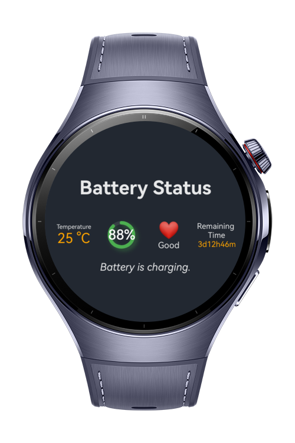
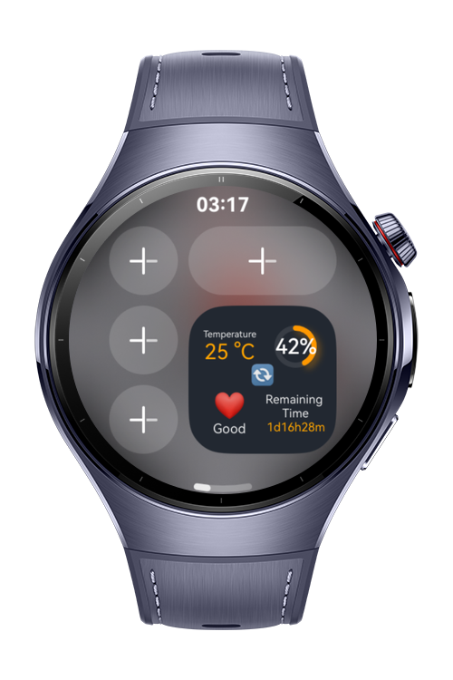

> **Note:** To access all shared projects, get information about environment setup, and view other guides, please visit [Explore-In-HMOS Index](https://github.com/Explore-In-HMOS/hmos-index).

# How to use Battery Kit

This project demonstrates the use of the Battery Kit on Huawei smart watches. It includes both a widget and an app for tracking battery status, such as battery health, estimated remaining time, battery temperature, and more.
# Preview

<p align="left">
    
    
</p>


# Use Cases

Tracking current battery capacity, battery health, estimated remaining time, battery temperature and charging status.

# Tech Stack
**Languages**: ArkTS, ArkUI  
**Frameworks**: HarmonyOS SDK 6.0.0
**Tools**: DevEco Studio 6.0.0
**Libraries/Kits**:
- @kit.BasicServicesKit
- @kit.AbilityKit
- @kit.PerformanceAnalysisKit


# Directory Structure
```
entry\src\main
├───ets
│   ├───batterywidget
│   │   ├───components
│   │   │       BatteryHealth.ets
│   │   │       BatteryPower.ets
│   │   │       BatterySOC.ets
│   │   │       BatteryTemperature.ets
│   │   └───pages
│   │           BatteryWidgetCard.ets
│   ├───entryformability
│   │       EntryFormAbility.ets
│   ├───lib
│   │       Battery.ets
│   ├───models
│   │       HealthModel.ets
│   │       PowerModel.ets
│   │       SOCModel.ets
│   │       TemperatureModel.ets
│   └───pages
│           Index.ets
│
└───resources
     └──base
         └──profile
                form_config.json   
```

# Constraints and Restrictions

## Supported Device
- Huawei Watch 5

# Limitations

- The widget updates every 30 minutes if the update button is not used, due to system limitations on widget update frequency.
- The remaining battery time is calculated based on the Huawei Watch 5 (46mm) battery capacity. For other models, additional handling is required.
# License

**How to use Battery Kit** is distributed under the terms of the **MIT License**.  
See the [LICENSE](LICENSE) file for more information.  